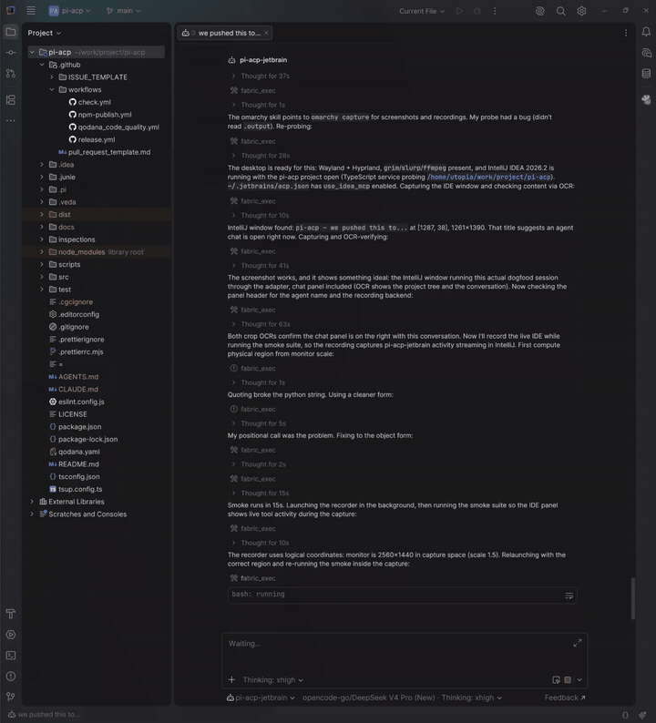
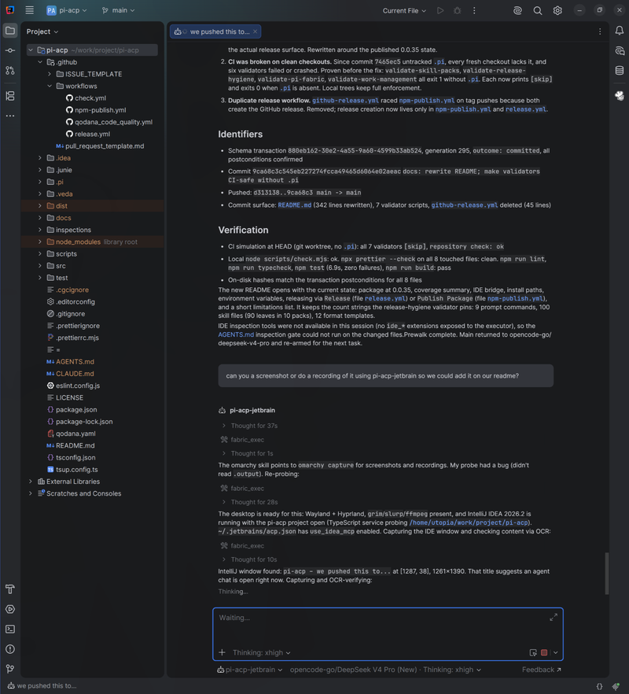

# pidea

[](LICENSE)
[](https://github.com/JohannesKaminski/pidea/actions/workflows/check.yml)

An Agent Client Protocol (ACP) adapter for the pi coding agent. JetBrains IntelliJ is the primary host. Other ACP clients work with partial coverage.

The adapter runs as an ACP server over stdio. Each ACP session starts one `pi --mode rpc` subprocess. The adapter translates messages between the client and pi.

This project started as a fork of [svkozak/pi-acp](https://github.com/svkozak/pi-acp) (via ryan-brosas/pi-acp-jetbrain) and has since diverged. The original MIT copyright is retained in [LICENSE](LICENSE).

## In action





## Install

You need Node.js 22.19 or newer and pi 1.0.0 or newer with a working model (run `pi` once in a terminal to check).

The adapter loads its bundled pi extensions (IDE bridge, tool approval, file access) into every pi session it starts, so installing the adapter is enough. `pi install` is not needed.

### Quick start (from a GitHub release)

Pick a version from the [releases page](https://github.com/JohannesKaminski/pidea/releases) and install its tarball:

```bash
npm install -g https://github.com/JohannesKaminski/pidea/releases/download/v0.1.0/pidea-0.1.0.tgz
pidea setup    # optional, JetBrains IDEs only
```

The tarball is prebuilt: the install needs no git, no build tools, and runs no install scripts.

To update, run `pidea update` and restart the IDE. It installs the latest release into the same global npm folder, so `pidea setup` does not need to run again. `pidea update --check` only reports the installed and latest versions.

If `npm install -g` fails with `EACCES` or asks for sudo, your Node.js was installed system-wide. Don't use sudo; either install Node.js with a version manager such as nvm (recommended), or point npm's global prefix at your home folder (not on Windows): `npm config set prefix ~/.local` and add `~/.local/bin` to your `PATH`. See npm's guide on [resolving EACCES permissions errors](https://docs.npmjs.com/resolving-eacces-permissions-errors-when-installing-packages-globally).

Installing straight from the git repository (`npm install -g github:…`) does not work: npm runs the build of a global git install without the build tools.

`pidea setup` is optional and only matters for JetBrains IDEs; other ACP clients just need `pidea` as the agent command. It writes the agent entry into `~/.jetbrains/acp.json` for you: the absolute path of the `node` that ran it, the adapter's `dist/index.js`, the path of `pi`, and an explicit `PATH`. Other agents and your own settings in that file (for example `idea_mcp_allowed_tools`) are kept, and the original file is saved once as `acp.json.bak`. Restart the IDE and pick `pidea` in the AI Chat.

Options: `--dry-run` prints the result without writing, `--name <entry>` changes the entry name, `--config <path>` targets another file. Run `pidea setup` again after switching node versions (nvm) or moving pi. It refuses to run from the `npx` cache, since that path can disappear.

The installed command is `pidea`.

### From a tarball (another machine)

Pack the adapter on a machine with the repository:

```bash
npm install
npm pack        # builds dist/ and writes pidea-<version>.tgz
```

Copy the tarball to the other machine and run:

```bash
npm install -g ./pidea-<version>.tgz
pidea setup
```

The tarball can be deleted afterwards. To update, install a newer tarball and restart the IDE.

The package version does not change between local builds. The startup block and `initialize` report the build revision (git commit), which tells builds apart.

### From source

```bash
npm install
npm run build
node dist/index.js setup
```

### Manual setup

`pidea setup` is a convenience. To write the entry yourself, see the next section.

### Register the adapter in IntelliJ

In the AI Chat tool window, open the menu in the upper-right corner and choose **Add Custom Agent**. IntelliJ creates `~/.jetbrains/acp.json` (the file and folder do not exist before) and opens it. A complete example; replace the placeholders with the absolute paths from `which pidea`, `which node`, and `which pi`:

```json
{
  "default_mcp_settings": {
    "use_idea_mcp": true,
    "use_custom_mcp": true
  },
  "agent_servers": {
    "pidea": {
      "command": "/path/to/pidea",
      "args": [],
      "env": { "PATH": "/folder/of/node:/folder/of/pi:/usr/local/bin:/usr/bin:/bin" }
    }
  }
}
```

- `use_idea_mcp` is off by default in IntelliJ. Without it IntelliJ sends no IDE tools, and the IDE bridge has nothing to expose.
- `pidea`, `npx`, and pi's launcher all start with `#!/usr/bin/env node`, so the agent process needs the folders of both `node` and `pi` on its PATH. Depending on how the IDE was started (desktop launcher, Dock, JetBrains Toolbox), it may not see the PATH your shell sets up in `.bashrc`, `.zshrc`, or `.profile`. Setting `PATH` in `env` makes it explicit, but it replaces the inherited PATH rather than adding to it: list every folder the adapter needs. A missing folder shows up as "ACP process exited unexpectedly. Exit code 127".
- Typical folders: `/usr/local/bin` or `/usr/bin` for system packages, `/opt/homebrew/bin` for Homebrew on Apple silicon, and `~/.nvm/versions/node/<version>/bin` (written out absolutely) for nvm; other version managers have similar versioned folders.
- Without relying on PATH: use the full path to `node` as `command`, the adapter's `dist/index.js` as the argument, and set `PIDEA_PI_COMMAND` to the full path of `pi`.
- On Windows, `pi`, `pidea`, and `npx` are `.cmd` launchers: find them with `where pidea`, `where node`, and `where pi`, and separate `PATH` entries with `;`.
- Restart the IDE after changing `acp.json`, and open a new chat after updating the adapter. IntelliJ reuses running agent processes and caches some agent UI until it restarts.

A development profile with a conservative IDE tool subset:

```json
{
  "agent_servers": {
    "pidea": {
      "command": "/path/to/pidea/dist/index.js",
      "args": [],
      "env": {
        "PIDEA_PI_COMMAND": "/path/to/pi",
        "PIDEA_DEBUG_BRIDGE": "1"
      },
      "idea_mcp_allowed_tools": [
        "search_symbol",
        "get_symbol_info",
        "analyze_calls",
        "search_text",
        "search_regex",
        "get_file_problems",
        "lint_files",
        "build_project",
        "execute_run_configuration",
        "git_status",
        "get_repositories",
        "get_project_modules",
        "get_project_dependencies",
        "list_directory_tree",
        "read_file",
        "search_file",
        "open_file_in_editor",
        "get_all_open_file_paths",
        "skill_search"
      ]
    }
  }
}
```

`idea_mcp_allowed_tools` acts as a deny-all mask plus the named tools. Add tools as you need them.

## Features

### Sessions

The adapter covers the session surface: `session/new`, `session/prompt`, `session/cancel`, `session/list`, `session/load`, `session/fork`, `session/resume`, `session/close`, `session/delete`. Pi keeps its own session files. The adapter keeps a small map at `~/.pi/pidea/session-map.json` so a load can reattach to the stored session.

Reopening a chat (IntelliJ uses `session/load`) replays the history from pi's stored session, tool calls included, with the same titles and kinds as live.

Clients that render Mermaid diagrams (IntelliJ declares this) get a hint in pi's system prompt, so pi can answer with diagrams. When pi names the session, the chat title follows; when pi changes the thinking level on its own (an extension, `/thinking`), the thinking selector follows; and a failing pi extension shows up as a notice in the chat instead of failing silently.

Each session starts with a startup block (adapter build, pi version, loaded context, skills, prompts, and extensions). It follows pi's `quietStartup` setting: `true` hides it, and `"header"` keeps the version lines and hides the listing. An update notice and IDE bridge problems still show.

### Session settings

Each session offers these options next to the chat input or in the model dialog:

| Setting       | Values                                                              | Default            | Environment default                   |
| ------------- | ------------------------------------------------------------------- | ------------------ | ------------------------------------- |
| Model         | pi's available models                                               | pi's default       |                                       |
| Thinking      | the levels the current model supports                               | pi's default       |                                       |
| Tool approval | Off, Ask for edits & commands, Ask for everything                   | Off                | `PIDEA_TOOL_APPROVAL=off\|edits\|all` |
| File access   | Through the editor, Disk (only with client file read/write support) | Through the editor | `PIDEA_FILE_ACCESS=disk\|editor`      |

IntelliJ applies setting changes right before the next prompt.

**Thinking** is a `thought_level` config option. It is not sent as session modes, so clients show one thinking selector; `session/set_mode` still accepts a level for older clients. The model selector works through a mapping from pi models to ACP provider info. Pi keeps provider credentials outside the RPC surface.

**Tool approval.** pi has no approval step of its own. A bundled pi extension pauses each tool call that needs approval and asks the client through `session/request_permission`, attached to that tool call, with Allow, Always allow (that tool, for the rest of the session), and Reject. A rejected tool does not run. "Ask for edits & commands" lets read, grep, find, and ls run without asking.

**File access.** Through the editor, pi's read, edit, and write tools go through the client's `fs/read_text_file` and `fs/write_text_file`: pi sees unsaved changes, and its edits land in the editor, where you can undo them. In IntelliJ these writes also reach the disk, so later shell commands see them. Writing a file through the editor saves that file, including unsaved changes you had in it. Search tools (grep, find, ls), shell commands, and images keep using the disk.

### Streaming and tool calls

Assistant text streams as `agent_message_chunk`. Reasoning streams as `agent_thought_chunk` when the provider sends it. Every chunk carries a `messageId`: the thinking and text of one pi reply share one, and each adapter notice and replayed message gets its own.

Tool runs map to `tool_call` and `tool_call_update` with the pi tool `name`, an ACP kind, and a readable title built from the arguments: `Read src/a.ts (lines 10–14)`, `Search for "TODO" in src`, `List src`, `Edit README.md`. Bash calls use the command as the title and stream their output as a terminal; a single read-only command (`ls`, `grep`, `rg`, `find`, `cat`, `head`, …, without pipes, chaining, or redirection) gets the search or read kind, anything else stays execute. Extension and IDE tools keep their pi name as the title. Images in tool results (pi's read tool on an image file, images generated in codemode with pi 1.0's `models.generateImages()`) reach the client as image content.

pi enables only read, bash, edit, and write by default. Add `"defaultTools": ["+grep", "+find", "+ls"]` to `~/.pi/agent/settings.json` for dedicated search tools; otherwise pi searches through bash.

Edit events carry a file location when pi reports a path. The adapter resolves relative paths against the session working directory. For text edits it finds the changed line from one unique match and reports a structured diff.

### Turn outcomes

A turn ends with `max_tokens` when the model hit its output limit and `cancelled` when it was stopped. A failed turn (provider error, pi crash) returns a JSON-RPC error with pi's message; IntelliJ shows it above the input box. Errors pi retries on its own, and context overflows it recovers from by compacting, don't end the turn: the chat shows retry and compaction notices instead.

### Usage and cost

When a turn settles the adapter makes one `get_session_stats` call and reports two things from it. Context window occupancy from pi `contextUsage`, with the cumulative session cost in USD, goes out as an ACP `usage_update` before the prompt resolves. Cumulative token use and cost go on the unstable `usage` field of the prompt response. The call waits at most 1 second. If it fails or times out, the turn still ends and both reports are left out. A turn that ends without settling (pi error, process exit) fetches the stats once for the `usage` field only.

The adapter also sends `usage_update` on `session/new` and `session/load`, and after a model switch. Right after compaction pi has no trusted token count, so the client keeps the previous value.

### Attached files and selections

IntelliJ attaches a file as a link and an editor selection as a pointer in byte offsets, not as text. The adapter resolves the pointer before pi sees the prompt: it reads the file the way the File access setting says (through the editor, unsaved changes included, or from disk), and gives pi the selected code with its file and line range. A pointer that doesn't fit the file passes through unchanged. Embedded context (`PIDEA_ENABLE_EMBEDDED_CONTEXT`) makes no difference in IntelliJ, which sends the same blocks either way.

### Input requests

Text input requests from pi extensions use ACP elicitation when the client declares form elicitation in `initialize`; otherwise they are cancelled with a visible notice. Requests that fit permissions route through ACP permissions. An editor request shows a cancellation notice because elicitation forms hold primitive fields only.

### Slash commands

Slash commands load file-based prompts from pi and a set of built-ins: `/compact`, `/export`, `/session`, `/name`, `/queue`, `/changelog`, `/steering`, `/follow-up`. Skills appear as `/skill:<name>` when enabled in pi settings. `/compact` on a session too small to compact answers in the chat.

## JetBrains IDE bridge

IntelliJ sends its built-in MCP server descriptor with each chat (with `use_idea_mcp` enabled). The adapter exposes those IDE tools to pi as `ide_<server>_<tool>` extension tools.

The bridge opens a direct MCP-over-SSE client against `http://127.0.0.1:<IJ_MCP_SERVER_PORT>/sse` when the descriptor carries that port. It starts the stdio child only when that endpoint is unreachable.

Two allowlists guard the IDE tools. The IDE side reads `idea_mcp_allowed_tools` from `~/.jetbrains/acp.json`. An omitted key means AllowAll in the installed build. The adapter side deny-lists `execute_tool` and every `xdebug_*` name. Set `PIDEA_IDE_EXTRA_TOOLS` with a comma separated list of remote names to re-allow tools you reviewed.

The session catalog never changes. After you edit IntelliJ MCP settings or the allowlist, open a new chat.

## Environment variables

| Variable                               | Effect                                                                                                                                              |
| -------------------------------------- | --------------------------------------------------------------------------------------------------------------------------------------------------- |
| `PIDEA_PI_COMMAND`                     | Path to the pi executable. Default: `pi`.                                                                                                           |
| `PIDEA_TOOL_APPROVAL=off\|edits\|all`  | Default tool approval mode for new sessions. Default: `off`.                                                                                        |
| `PIDEA_FILE_ACCESS=disk\|editor`       | Default file access for read/edit/write in new sessions, for clients with fs support. Default: `editor`.                                            |
| `PIDEA_DEBUG_ACP=1` or a file path     | Log incoming ACP requests and outgoing errors to `~/.pi/pidea/acp-debug.log` (or the given file). Prompt text, images, env and headers are omitted. |
| `PIDEA_DEBUG_BRIDGE=1`                 | Log the sanitized `session/new` MCP descriptor to stderr. IntelliJ writes that stderr into `idea.log`.                                              |
| `PIDEA_ENABLE_EMBEDDED_CONTEXT=true`   | Advertise `embeddedContext` support.                                                                                                                |
| `PIDEA_ENFORCE_IDE_INSPECT=0`          | Disable the inspection gate that runs after each turn.                                                                                              |
| `PIDEA_ENFORCE_IDE_MUTATIONS=0`        | Disable the mutation provenance gate. See the IntelliJ-first coding mode section.                                                                   |
| `PIDEA_IDE_MODE=off\|prefer\|required` | IntelliJ-first coding mode for the session. Default: `off`. See the IntelliJ-first coding mode section.                                             |
| `PIDEA_IDE_INSPECT_DIR`                | Move inspection reports out of the project tree.                                                                                                    |
| `PIDEA_SESSION_MAP`                    | Override the session map path. Default: `~/.pi/pidea/session-map.json`.                                                                             |
| `PIDEA_IDE_EXTRA_TOOLS`                | Re-allow deny-listed IDE tools. Comma separated remote names.                                                                                       |
| `PIDEA_UPDATE_CHECK=0`                 | Disable update checks (the "New version available" notice for pi).                                                                                  |

## IntelliJ-first coding mode

Set `PIDEA_IDE_MODE` to control how the session uses IntelliJ for normal coding work. Pi still generates every implementation; IntelliJ opens, reads, searches, applies, renames, reformats, and validates.

- `off` (default) keeps the current behavior: IDE tools are exposed alongside native tools, nothing is removed, no extra prompt guidance.
- `prefer` removes the native `read`, `edit`, `write`, `grep`, `find`, and `ls` tools from the active set when the required IDE capabilities register. If the IDE bridge degrades, those tools come back and the session gets an explicit fallback notice.
- `required` removes the same native tools immediately and keeps them removed if the IDE bridge is missing or loses connection. The session reports that the task is blocked until a new healthy chat starts.

Required capabilities: `read_file`, `open_file_in_editor`, `apply_patch`, `create_new_file`, one search tool, and one inspection tool. Tool names are discovered from the live catalog, never guessed.

In active modes, mutations run through IntelliJ and open the affected files: existing files open before `apply_patch`, created and moved files open after. Patch targets and path arguments are confined to the ACP project root; paths outside it are rejected, including symlink escapes. Structured path fields in search and inspection results are checked against the project root. In `prefer`, results naming files outside the root are diagnosed on the result; in `required`, they are rejected. Unstructured result text is passed through unchanged: generic text scanning is not a safe discriminator, so per-tool structured adapters remain the boundary (an upstream limitation).

Bash stays available in `prefer` for Git, tests, builds, and diagnostics. Unrestricted bash can still mutate files, so this mode is policy enforcement for normal coding tools, not a filesystem sandbox. Do not rely on it as a security boundary.

In `prefer` and `required` with an active catalog, direct Fabric/Schema file mutations (`schema.commit`, `pi.write`, `pi.edit` inside `fabric_exec`) are blocked before execution by a `tool_call` gate. Mutations must flow through the IDE tools (`ide_idea_apply_patch`, `ide_idea_create_new_file`, rename, reformat), which open affected files and confine patch/path arguments to the project root. Read-only Fabric code (`pi.read`, `pi.grep`, IDE tool calls) is unaffected. This closes the extension-tool bypass of the active-set filter; Bash remains an intentional, documented exception.

A second layer runs after each turn: the extension reports paths applied by successful IDE mutation tools over the authenticated IPC (`mutations_applied`), and the adapter compares those against files changed during the turn (git status merged with turn-touched tool paths). Files that changed without an IDE mutation event are surfaced as `Mutation provenance` violations in the chat and recorded under `PromptResponse._meta.pidea.mutationViolations`. Disable with `PIDEA_ENFORCE_IDE_MUTATIONS=0`. Deleted files and files committed mid-turn by an external commit are not detected by this layer (same git-status semantics as the inspection gate).

The File access setting is the protocol-standard way to route pi's read, edit, and write through the editor in any ACP client; this mode goes further and replaces pi's native tools with IntelliJ's MCP tools.

Set the variable for the adapter process, for example in `~/.jetbrains/acp.json`:

```json
{
  "agent_servers": {
    "pidea": {
      "command": "/path/to/pidea/dist/index.js",
      "env": { "PIDEA_IDE_MODE": "prefer", "PIDEA_PI_COMMAND": "/path/to/pi" }
    }
  }
}
```

## Authentication

The adapter advertises terminal auth metadata. Run this command for interactive provider login:

```bash
pidea --terminal-login
```

ACP clients can start the same command from their auth UI.

## Development

```bash
npm install
npm run dev          # run from src with tsx
npm run build
npm run lint
npm run test         # unit, component, and end-to-end tests
npm run typecheck
npm run format
npm run check:pack   # pack, install into a clean prefix, check the installed adapter starts
npm run smoke        # core stdio smoke tests against your real pi and model
npm run smoke:full   # full matrix; run this before a release
node scripts/check.mjs
```

Code layout:

- `src/acp/` holds the ACP server and translation.
- `src/pi-rpc/` holds the pi subprocess wrapper.
- `src/pi-extension/` holds the pi extensions the adapter loads into each session: the IDE bridge, tool approval, editor file access, and client hints.

Tests:

- `test/e2e/` runs the real adapter against the real pi binary from `node_modules`, with a scripted model (pi-ai's faux provider, loaded by `test/e2e/fixtures/scripted-model.ts`). Scenarios script text, thinking, tool calls, stop reasons, and errors; no network or API keys. Start a fix with a failing scenario here.
- `test/component/` and `test/unit/` cover edge cases with a fake pi process. Its events are type-checked against pi's exported event types, so a renamed pi event fails `npm run typecheck`.
- `npm run smoke:full` uses your own pi providers and is for release checks.

To see what a client actually sends, set `PIDEA_DEBUG_ACP=1` and read `~/.pi/pidea/acp-debug.log`.

CI: `check.yml` runs the canonical check, tests, lint, typecheck, build, and the packaging check on Linux (Node 22 and 24) and Windows (Node 24). `release.yml` runs on `v*` tags: the end-to-end tests against pi 1.0.0 and the latest pi, the same checks, a tag-matches-version check, and then it publishes a GitHub Release with the `npm pack` tarball.

Releasing:

1. Set `version` in `package.json`, run `npm install --package-lock-only`, and update the version in the Quick start install command.
2. Run `npm run smoke:full` locally (it needs your pi providers, which CI does not have).
3. Commit, then tag and push: `git tag v<version>` and `git push origin main v<version>`.

## Limitations

### Trust boundary

The adapter trusts its ACP host. The host supplies the session working directory and
client-provided MCP descriptors; stdio MCP servers named in a descriptor are spawned with
the adapter's process environment in that working directory. Run the adapter only with
hosts and MCP configurations you control. Do not expose it as a service to untrusted clients
or place unnecessary secrets in the adapter environment.

`PIDEA_IDE_MODE=prefer|required` is policy enforcement for normal coding tools, not a
filesystem sandbox: unrestricted Bash stays available, and the post-turn gates report
violations without rolling back changes.

Tool approval covers tool calls pi makes. Calls one tool makes on behalf of another (pi's optional codemode) carry ids the client never sees as tool calls, so their approval prompt is not attached to a visible call.

### Protocol coverage

- Terminals: the adapter does not delegate shell commands to the client (IntelliJ declares no terminal support). Pi runs commands locally.
- File access through the editor covers read, edit, and write only; search tools and shell commands use the disk.
- `providers/set` and `providers/disable` return a method-not-found error. Pi configures providers outside the RPC surface.
- No plan updates: pi has no plan concept.
- No `logout` and no additional workspace roots: pi's RPC surface has neither.
- The IDE bridge speaks the MCP-over-ACP protocol generation with `mcp/connect`. ACP SDK 1.x defines a newer, stateless one; current IntelliJ builds accept the older form.

Debugger tools register only while an IDE debug session is live. Start a debug session and open a new chat to see them.

After you rebuild the adapter, open a new chat. Node keeps the old files loaded, and IntelliJ reuses running agent processes.

## License

MIT. See [LICENSE](LICENSE).
